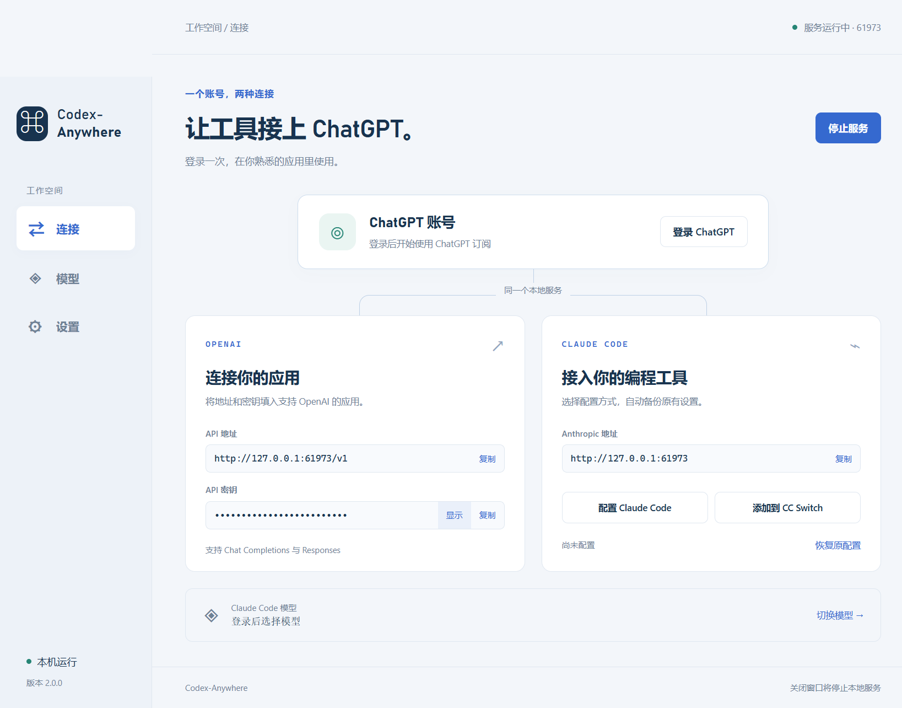
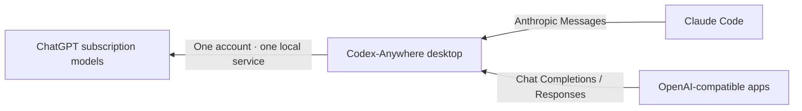

<div align="center">

# Codex-Anywhere

[简体中文](../README.md) · [繁體中文](README.zh-TW.md) · [English](README.en.md)

**Use your ChatGPT subscription through a local API key.**

[Download for Windows](https://github.com/NamelessDDDoge/Codex-Anywhere/releases/latest) · [Usage guide](USER-GUIDE.txt) · [Contributing](CONTRIBUTING.md)


[](../LICENSE)

</div>



*Actual Electron window before sign-in, captured with isolated test data and a masked key. The temporary test port shown differs from the default `17863`.*

Codex-Anywhere brings the former **Plan Bridge** and **API Gateway** together in one standalone Electron application. Sign in once, start one local service, and connect Claude Code or applications that accept an OpenAI-compatible API. Desktop installers are the only release format.

The app uses OpenAI's Sign in with ChatGPT Devkit. Eligible accounts can authorize requests against their ChatGPT plan allowance through this [documented integration](https://developers.openai.com/cookbook/articles/sign-in-with-chatgpt). It does not reverse-proxy the ChatGPT website or reuse browser cookies. The bridge translates client requests locally; its API key secures that local service and is not an OpenAI platform API key.

Use remains subject to account eligibility, plan limits, OpenAI's terms, and the Devkit's noncommercial license. This integration does not establish blanket compliance for every use or guarantee that an account cannot be suspended; OpenAI's [Terms of Use](https://openai.com/policies/terms-of-use/) still apply.



## Get connected

1. Download the Windows x64 installer from [the latest release](https://github.com/NamelessDDDoge/Codex-Anywhere/releases/latest) and open **Codex-Anywhere**. The desktop package includes its runtime; a separate Node.js installation is unnecessary.
2. Sign in with ChatGPT in your browser, then refresh the available models.
3. Start the local service. Copy its URL and local API key into your application, or use the Claude Code connection controls.

Claude Code and CC Switch are optional, separately installed clients. You do not need either for OpenAI-compatible applications.

Closing the window hides the app to the system tray and keeps the local service running. Click the tray icon or reopen the app to restore the window. To stop the service and quit, right-click the tray icon and choose “退出” (Exit).

## One place for every connection

| You want to… | In Codex-Anywhere |
| --- | --- |
| Use an OpenAI-compatible app | Copy the base URL and local API key; use `/v1/models` to find a model ID. |
| Connect Claude Code | Apply direct configuration, or add the provider to CC Switch. |
| Change models | Refresh the account catalog and choose from the available models. |
| Manage the service | Start or stop it and check its status. |
| Adjust your setup | Set a proxy or launch the app when you sign in to Windows. |
| Undo client configuration | Restore the backed-up settings through the integration controls. |

Client configuration changes are explicit. Backups protect existing settings; restoration preserves unrelated changes where possible. Restart Claude Code after changing its connection. For CC Switch, select the configured provider in CC Switch.

The desktop app supports Simplified Chinese, Traditional Chinese, and English. On first launch it uses your preferred system language, falling back to English for other languages. Change it under **Settings → Display language**, or select **System default**. Confirming saves the choice and automatically restarts the app; canceling keeps the previous setting. Restarting stops the local service and interrupts active requests.

### OpenAI-compatible applications

```text
Base URL   http://127.0.0.1:17863/v1
API key    Copy from the desktop app
Model      Use an ID returned by GET /v1/models
```

The local API key authenticates your applications to the bridge. It is separate from your ChatGPT authorization and should not be shared.

| Endpoint | Use |
| --- | --- |
| `GET /v1/models` | Discover available models. |
| `POST /v1/chat/completions` | OpenAI Chat Completions, including streaming and tools. |
| `POST /v1/responses` | OpenAI Responses. |
| `POST /v1/messages` | Anthropic Messages for Claude Code. |

All endpoints use the same local service and credentials. The default address is loopback-only. The old separate gateway port `17864` is no longer the default.

## Upgrade and troubleshoot

Quit the old Bridge/Gateway manager and stop its service before opening the desktop app. Existing data stays in place: the app reuses `%LOCALAPPDATA%\ChatGPTClaudeBridge` first, then `%LOCALAPPDATA%\ChatGPTGateway` if no Bridge directory exists. A fresh installation uses `%LOCALAPPDATA%\ChatGPTBridge`. When both legacy directories exist, Bridge takes precedence; credentials are not merged or copied.

If Claude Code reports `ECONNREFUSED`, check the address in the error. CC Switch may point Claude Code at `127.0.0.1:15721`; that proxy can be offline even while Codex-Anywhere on `17863` is healthy. Start CC Switch and its proxy, or explicitly choose direct Claude Code configuration in the desktop app.

In **Settings**, save the proxy before clicking **Test connection**. This checks the saved proxy, authorization/API connectivity, and Claude Code's current local route. It does not send a model prompt or display credentials.

## What to know

- **Account access:** your subscription determines models, quota, and upstream limits. The app cannot grant additional access. Model names and availability may change.
- **Reasoning effort:** explicit supported levels pass through to the upstream model. Unsupported levels return an error. Equal level names do not imply equal compute across models.
- **Context windows:** a client's `[1M]` setting does not increase the server's context limit. Token counts and client cost displays are estimates.
- **Platform:** the desktop release targets Windows x64. Other architectures and operating systems are not published desktop targets in this release.
- **Privacy:** authorization stays local; never include credentials, local API keys, or personal prompts in issues. Client settings and credentials are not part of the release package.
- **Validation:** [VALIDATION.md](VALIDATION.md) and [reports/](reports/) contain historical protocol results. They are not proof that every desktop flow or every current account model has been tested live.

> [!IMPORTANT]
> For personal, noncommercial experimentation. The bundled OpenAI Devkit has a noncommercial license. This is an independent project, not an official OpenAI, Anthropic, or CC Switch product.

## Development

Use Windows, Node.js 24, and PowerShell:

Source lives in `src/core/` (API and integrations) and `src/desktop/` (Electron). Build helpers are in `scripts/`, tests in `tests/`, and guides and historical reports in `docs/`.

```powershell
npm ci
npm start
```

```powershell
npm test                 # Offline backend regression tests
npm run test:desktop     # Desktop UI tests
npm run dist             # Build the Windows desktop installer
```

The installer is named `Codex-Anywhere-Setup-1.0.1-x64.exe`. Building an installer does not publish a release. Online tests require an authorized account and consume subscription quota; keep their outputs private until sanitized.

See [CONTRIBUTING.md](CONTRIBUTING.md) for development and test isolation. Preserve [third-party notices](THIRD-PARTY-NOTICES.md), the [project license](../LICENSE), and the [OpenAI Devkit license](../vendor/siwc/LICENSE).


### OpenAI examples

The home page includes a live model ID, a minimal Python chat example, and reasoning-effort mappings. See [OpenAI / DeepSeek Harness examples](OPENAI-EXAMPLES.md).
