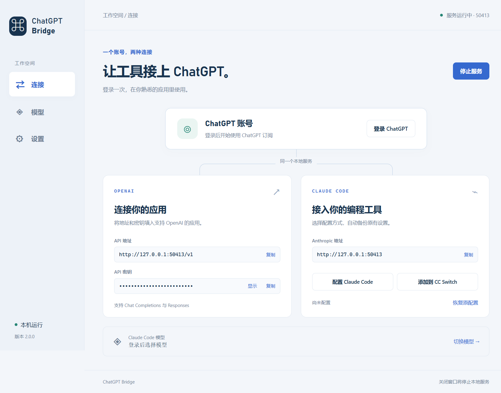
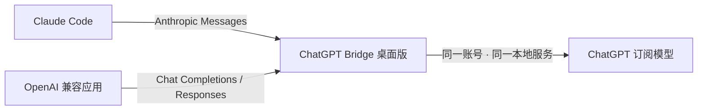

<div align="center">

# ChatGPT Bridge

**一个 ChatGPT 账号，一个桌面应用，连接你常用的工具。**

[English](../README.md) · [简体中文](README.zh-CN.md) · [繁體中文](README.zh-TW.md)

[下载 Windows 桌面版](https://github.com/NamelessDDDoge/chatgpt-plan-bridge/releases/latest) · [使用指南](USER-GUIDE.txt) · [参与开发](CONTRIBUTING.md)


[](../LICENSE)

</div>



*真实 Electron 未登录界面，使用隔离测试数据，密钥已遮蔽。截图为临时测试端口，默认端口为 `17863`。*

ChatGPT Bridge 将原来的 **Plan Bridge** 和 **API Gateway** 合并为独立的 Electron 桌面软件。登录一次，启动一个本地服务，即可连接 Claude Code 或支持 OpenAI 兼容接口的应用。Release 只提供桌面安装包。



## 开始使用

1. 从[最新 Release](https://github.com/NamelessDDDoge/chatgpt-plan-bridge/releases/latest) 下载 Windows x64 安装包，安装并打开 **ChatGPT Bridge**。安装包包含运行环境，无须另装 Node.js。
2. 在浏览器中完成 ChatGPT 登录，再刷新可用模型。
3. 启动本地服务。将地址和本地 API Key 复制到应用，或使用界面中的 Claude Code 接入功能。

Claude Code 和 CC Switch 是可选客户端，需要单独安装。使用 OpenAI 兼容应用时不需要它们。

## 一个窗口管理连接

| 想做什么 | 在 ChatGPT Bridge 中操作 |
| --- | --- |
| 连接 OpenAI 兼容应用 | 复制 Base URL 和 API Key；通过 `/v1/models` 获取模型 ID。 |
| 连接 Claude Code | 应用直连配置，或添加 CC Switch 供应商。 |
| 选择模型 | 刷新账号模型列表，从可用模型中选择。 |
| 管理服务 | 启动、停止、查看状态。 |
| 调整运行方式 | 设置代理或 Windows 登录时启动。 |
| 撤销客户端配置 | 通过接入设置恢复备份。 |

修改客户端配置需要主动操作，并会备份原设置；恢复时尽量保留无关修改。更改连接后重启 Claude Code。使用 CC Switch 时，在 CC Switch 中选择已配置的供应商。

### 接入 OpenAI 兼容应用

```text
Base URL   http://127.0.0.1:17863/v1
API Key    从桌面应用复制
Model      使用 GET /v1/models 返回的模型 ID
```

本地 API Key 用于应用连接桥接服务，与 ChatGPT 登录授权分开，请勿分享。

| 接口 | 用途 |
| --- | --- |
| `GET /v1/models` | 获取可用模型。 |
| `POST /v1/chat/completions` | OpenAI Chat Completions，支持流式输出及工具调用。 |
| `POST /v1/responses` | OpenAI Responses。 |
| `POST /v1/messages` | Claude Code 使用的 Anthropic Messages。 |

这些接口共用一个本地服务和一套凭据。默认只监听本机地址；旧版网关的 `17864` 不再是默认端口。

## 升级与排查

升级前先退出旧版 Bridge/Gateway 管理器并停止旧服务。已有数据保留原位置：优先沿用 `%LOCALAPPDATA%\ChatGPTClaudeBridge`；不存在时沿用 `%LOCALAPPDATA%\ChatGPTGateway`；全新安装使用 `%LOCALAPPDATA%\ChatGPTBridge`。两个旧目录都存在时优先使用 Bridge，不合并或复制凭据。

Claude Code 出现 `ECONNREFUSED` 时，先看报错中的地址。CC Switch 可能让 Claude Code 连接 `127.0.0.1:15721`；即使 Bridge 的 `17863` 服务正常，这个代理也可能没有启动。打开 CC Switch 并启动代理，或在桌面应用中主动选择“配置 Claude Code”使用直连。

在“设置”中先保存代理，再点击“检测连接”。检测会检查已保存的代理、授权/API 连通性以及 Claude Code 当前使用的本地地址，不发送模型提示词，也不显示凭据。

## 使用范围

- **账号权限：** 模型、额度和服务端限制取决于你的订阅；软件不会增加权限。可用模型可能变化。
- **推理强度：** 显式指定的受支持等级原样传给上游；不支持的等级返回错误。同名等级不代表各模型使用相同算力。
- **上下文：** 客户端的 `[1M]` 设置不会增加服务端限制。Token 统计和客户端费用显示属于估算。
- **平台：** 当前桌面 Release 面向 Windows x64，不发布其他架构或操作系统的桌面版本。
- **隐私：** 授权保存在本机。Issue 中不要上传凭据、API Key 或私人提示词；安装包不包含个人配置。
- **验证：** [VALIDATION.md](VALIDATION.md) 和 [reports/](reports/) 保留历史协议测试记录，不代表所有桌面操作或当前账号模型都已完成在线验证。

> [!IMPORTANT]
> 仅供个人、非商业实验。内置 OpenAI Devkit 使用非商业许可。本项目并非 OpenAI、Anthropic 或 CC Switch 官方产品。

## 开发

环境：Windows、Node.js 24、PowerShell。

`src/core/` 存放接口与接入逻辑，`src/desktop/` 存放 Electron 桌面代码；构建辅助脚本位于 `scripts/`，测试位于 `tests/`，指南和历史报告位于 `docs/`。

```powershell
npm ci
npm start
```

```powershell
npm test                 # 后端离线回归
npm run test:desktop     # 桌面界面测试
npm run dist             # 构建 Windows 桌面安装包
```

安装包名称为 `ChatGPT-Bridge-Setup-2.0.0-x64.exe`。本地构建不会自动发布 Release。在线测试需要自己的授权账号并消耗订阅额度，分享结果前请脱敏。

开发约定和测试隔离见 [CONTRIBUTING.md](CONTRIBUTING.md)。请保留[第三方声明](THIRD-PARTY-NOTICES.md)、[项目许可](../LICENSE)及 [OpenAI Devkit 许可](../vendor/siwc/LICENSE)。

