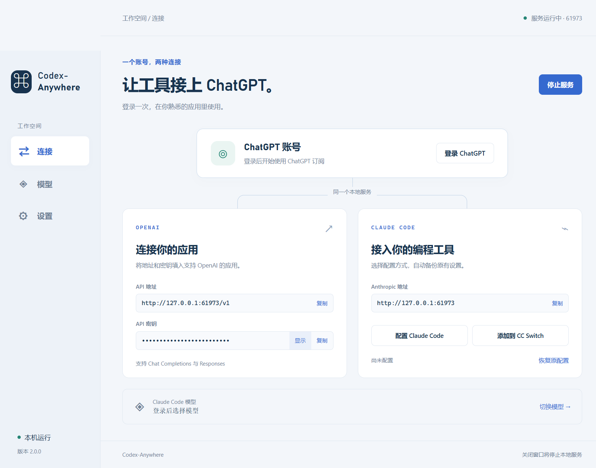
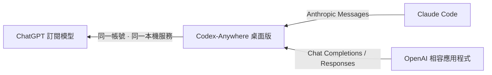

<div align="center">

# Codex-Anywhere

[简体中文](../README.md) · [繁體中文](README.zh-TW.md) · [English](README.en.md)

**透過本機 API Key 使用 ChatGPT 訂閱額度。**

[下載 Windows 桌面版](https://github.com/NamelessDDDoge/Codex-Anywhere/releases/latest) · [使用指南](USER-GUIDE.txt) · [參與開發](CONTRIBUTING.md)


[](../LICENSE)

</div>



*實際 Electron 未登入介面，使用隔離測試資料，金鑰已遮蔽。截圖為暫時測試連接埠，預設連接埠為 `17863`。*

Codex-Anywhere 將原來的 **Plan Bridge** 和 **API Gateway** 合併為獨立的 Electron 桌面軟體。登入一次，啟動一個本機服務，即可連接 Claude Code 或支援 OpenAI 相容介面的應用程式。Release 僅提供桌面安裝程式。

軟體使用 OpenAI 的 Sign in with ChatGPT Devkit，透過[官方文件介紹的授權方式](https://developers.openai.com/cookbook/articles/sign-in-with-chatgpt)，讓符合條件的帳號使用自己的 ChatGPT 方案額度。它不反向代理 ChatGPT 網頁，也不重用瀏覽器 Cookie。本機服務負責轉換用戶端請求；產生的 API Key 用於存取這個本機服務，並非 OpenAI 平台 API Key。

使用時仍須符合帳號資格、方案限制、OpenAI 條款和 Devkit 的非商業授權。採用官方授權方式不代表任何用途都完全合規，也不能保證零停權風險；具體使用須遵守 [OpenAI 使用條款](https://openai.com/policies/terms-of-use/)。



## 開始使用

1. 從[最新 Release](https://github.com/NamelessDDDoge/Codex-Anywhere/releases/latest) 下載 Windows x64 安裝程式，安裝並開啟 **Codex-Anywhere**。安裝程式包含執行環境，無須另裝 Node.js。
2. 在瀏覽器中完成 ChatGPT 登入，再重新整理可用模型。
3. 啟動本機服務。將位址和本機 API Key 複製到應用程式，或使用介面中的 Claude Code 連接功能。

Claude Code 和 CC Switch 是選用的用戶端，需要另外安裝。使用 OpenAI 相容應用程式時不需要它們。

點擊視窗關閉按鈕會隱藏到系統匣，本機服務繼續執行。點擊系統匣圖示或重新開啟軟體可恢復視窗；完全結束請右鍵點擊系統匣圖示，選擇「退出」。

## 一個視窗管理連接

| 想做什麼 | 在 Codex-Anywhere 中操作 |
| --- | --- |
| 連接 OpenAI 相容應用程式 | 複製 Base URL 和 API Key；透過 `/v1/models` 取得模型 ID。 |
| 連接 Claude Code | 套用直接連線設定，或新增 CC Switch 供應商。 |
| 選擇模型 | 重新整理帳號模型清單，從可用模型中選擇。 |
| 管理服務 | 啟動、停止、查看狀態。 |
| 調整執行方式 | 設定 Proxy 或 Windows 登入時啟動。 |
| 復原用戶端設定 | 透過連接設定還原備份。 |

修改用戶端設定需要主動操作，並會備份原設定；還原時盡量保留無關修改。變更連線後重新啟動 Claude Code。使用 CC Switch 時，在 CC Switch 中選擇已設定的供應商。

桌面介面支援簡體中文、繁體中文和 English。首次開啟時依系統首選語言選擇（其他語言使用英語）；可在「設定 → 介面語言」切換或選擇「跟隨系統」。確認後儲存並自動重新啟動，取消則保留原設定。重新啟動會停止本機服務並中斷進行中的請求。

### 連接 OpenAI 相容應用程式

```text
Base URL   http://127.0.0.1:17863/v1
API Key    從桌面應用程式複製
Model      使用 GET /v1/models 傳回的模型 ID
```

本機 API Key 用於應用程式連接橋接服務，與 ChatGPT 登入授權分開，請勿分享。

| 介面 | 用途 |
| --- | --- |
| `GET /v1/models` | 取得可用模型。 |
| `POST /v1/chat/completions` | OpenAI Chat Completions，支援串流輸出及工具呼叫。 |
| `POST /v1/responses` | OpenAI Responses。 |
| `POST /v1/messages` | Claude Code 使用的 Anthropic Messages。 |

這些介面共用一個本機服務和一組憑證。預設僅監聽本機位址；舊版閘道的 `17864` 不再是預設連接埠。

## 升級與排查

升級前先退出舊版 Bridge/Gateway 管理員並停止舊服務。既有資料保留原位置：優先沿用 `%LOCALAPPDATA%\ChatGPTClaudeBridge`；不存在時沿用 `%LOCALAPPDATA%\ChatGPTGateway`；全新安裝使用 `%LOCALAPPDATA%\ChatGPTBridge`。兩個舊目錄都存在時優先使用 Bridge，不合併或複製憑證。

Claude Code 出現 `ECONNREFUSED` 時，先查看錯誤中的位址。CC Switch 可能讓 Claude Code 連接 `127.0.0.1:15721`；即使 Bridge 的 `17863` 服務正常，這個 Proxy 也可能尚未啟動。開啟 CC Switch 並啟動 Proxy，或在桌面應用程式中主動選擇「配置 Claude Code」使用直接連線。

在「设置」中先儲存 Proxy，再按「检测连接」。檢測會檢查已儲存的 Proxy、授權/API 連通性及 Claude Code 目前使用的本機位址，不傳送模型提示詞，也不顯示憑證。

## 使用範圍

- **帳號權限：** 模型、額度和伺服器限制取決於你的訂閱；軟體不會增加權限。可用模型可能變動。
- **推理強度：** 明確指定的受支援等級原樣傳給上游；不支援的等級傳回錯誤。同名等級不代表各模型使用相同算力。
- **上下文：** 用戶端的 `[1M]` 設定不會增加伺服器限制。Token 統計和用戶端費用顯示屬於估算。
- **平台：** 目前桌面 Release 面向 Windows x64，不發布其他架構或作業系統的桌面版本。
- **隱私：** 授權儲存在本機。Issue 中不要上傳憑證、API Key 或私人提示詞；安裝程式不包含個人設定。
- **驗證：** [VALIDATION.md](VALIDATION.md) 和 [reports/](reports/) 保留歷史協定測試記錄，不代表所有桌面操作或目前帳號模型都已完成線上驗證。

> [!IMPORTANT]
> 僅供個人、非商業實驗。內建 OpenAI Devkit 使用非商業授權。本專案並非 OpenAI、Anthropic 或 CC Switch 官方產品。

## 開發

環境：Windows、Node.js 24、PowerShell。

`src/core/` 存放介面與連接邏輯，`src/desktop/` 存放 Electron 桌面程式碼；建置輔助腳本位於 `scripts/`，測試位於 `tests/`，指南和歷史報告位於 `docs/`。

```powershell
npm ci
npm start
```

```powershell
npm test                 # 後端離線回歸
npm run test:desktop     # 桌面介面測試
npm run dist             # 建置 Windows 桌面安裝程式
```

安裝程式名稱為 `Codex-Anywhere-Setup-1.0.1-x64.exe`。本機建置不會自動發布 Release。線上測試需要自己的授權帳號並消耗訂閱額度，分享結果前請去除敏感資訊。

開發約定和測試隔離見 [CONTRIBUTING.md](CONTRIBUTING.md)。請保留[第三方聲明](THIRD-PARTY-NOTICES.md)、[專案授權](../LICENSE)及 [OpenAI Devkit 授權](../vendor/siwc/LICENSE)。


### OpenAI 設定範例

首頁提供模型 ID、最簡單的 Python 聊天程式及思考強度對應說明，詳見 [OpenAI / DeepSeek Harness 設定範例](OPENAI-EXAMPLES.md)。

DeepSeek Harness 請使用桌面服務顯示的實際連接埠；profile 版的桌面與 headless 設定分別儲存，CLI 與桌面憑證格式也可能不同。上述指南包含設定方式與 `node scripts/live/harness.mjs` 實機工具呼叫檢查。
